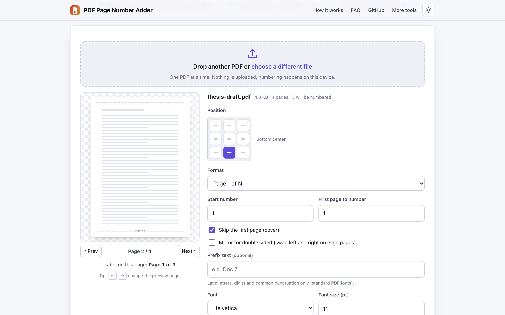
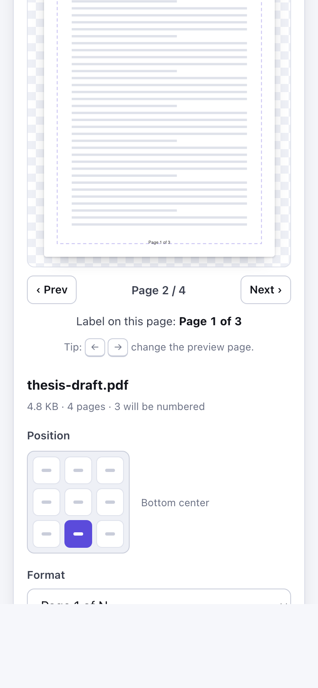

# PDF Page Number Adder

> Stamp page numbers on any PDF in your browser, with position, format and start number, no upload.

**🌐 Use it now: [turhe123.github.io/pdf-page-numbers-adder](https://turhe123.github.io/pdf-page-numbers-adder/)** · free · open source · runs in your browser · works offline


## Why

Page numbers are a routine need for theses, legal bundles and reports, and those documents are often private. PDF Page Number Adder is a free, open-source alternative to Sejda Add Page Numbers and PDF24, which upload your files, and where Sejda's free tier is limited to 3 tasks per hour and 50 pages, with ads. Here your files never leave the device, there is no account, no ads, no limits, it works offline and it can be installed as an app.

## Screenshots

<p align="center"></p>

<p align="center"><em>PDF Page Number Adder in the browser, light theme</em></p>

<p align="center"></p>

<p align="center"><em>PDF Page Number Adder on a phone</em></p>

## Features

- Drop or choose one PDF; the page count and file size are shown.
- Live schematic preview of any page with the label drawn at its scaled position, plus a margin guide. Step through pages with the Prev/Next buttons or the left and right arrow keys.
- Position on a three by three grid (default bottom center).
- Formats: `1`, `Page 1`, `1 of N`, `Page 1 of N`, and lowercase roman numerals (`i`, `ii`, `iii`). Numbers above 3999 fall back to digits in roman mode.
- Start number (default 1), first page to number, and a "skip the first page" option. N in "of N" is the last number printed, so it stays correct when pages are skipped.
- Optional prefix text (for example `Doc 7`), with a warning for characters the standard PDF fonts cannot draw.
- Mirror for double-sided printing: left and right swap on even pages.
- Font (Helvetica, Times, Courier), font size (4 to 72 pt, default 11), margin in millimeters (default 12) and color (default dark gray).
- Rotated pages get the label upright, and placement uses the page's crop box.
- Stamping runs in a Web Worker with progress text; the result line states how many pages were numbered.
- Saves a copy named `yourfile_numbered.pdf`. The original is not modified.
- Errors (not a PDF, damaged file, encrypted file) are shown inline.

**Input:** one PDF file at a time. **Output:** a PDF. **Limits:** encrypted or password-protected PDFs are not supported; labels use the standard Latin fonts only; the whole file is processed in memory in one pass, so very large files depend on your device's memory. The preview is a schematic page, not a render of the real page content.

## How to use

1. Drop a PDF onto the page, or choose one.
2. Pick the position on the grid and the format, then set the start number, first page and options such as skipping the cover or mirroring.
3. Check the preview and use the arrow keys to look at other pages.
4. Press **Apply and download**, or use the download button in the result line.

## Privacy

- Nothing is uploaded. The PDF is read and stamped in your browser.
- No cookies.
- Page views are counted anonymously with [GoatCounter](https://www.goatcounter.com/) (cookieless, open source).
- Works offline through a service worker once the page has loaded.

## Run it locally

```sh
git clone https://github.com/turhe123/pdf-page-numbers-adder
cd pdf-page-numbers-adder
python3 -m http.server 4173
```

Then open http://127.0.0.1:4173/. There is no build step.

## Tests

```sh
npm i -D @playwright/test && npx playwright install chromium
npx playwright test
```

## Third-party code

- [pdf-lib](https://pdf-lib.js.org/) 1.17.1, MIT license (`vendor/pdf-lib/`).

## Built with AI

PDF Page Number Adder was written by [Claude Code](https://claude.com/claude-code) inside an automated pipeline, from a plain-English spec. No code or assets from any commercial product were used; it is a clean-room implementation of a feature set, not a copy.

What that means in practice:

- The full source is in this repo under the MIT license. Read it before you trust it with your files.
- Everything runs in your browser. It makes no network requests except an anonymous, cookieless page-view count (GoatCounter); your files never leave the device.
- The page is tested headless in Chromium (Playwright) before every release, but it has had less human review than hand-written software. Bug reports and pull requests are welcome.

## Support ❤️

If this saved you time, you can support the project on [Ko-fi](https://ko-fi.com/leodavidai).

## More free web tools

See the rest at [turhe123.github.io/web-tools](https://turhe123.github.io/web-tools/).

Also: [free, open-source Mac apps](https://turhe123.github.io/mac-apps/) built the same way, native Swift, no accounts, no telemetry.

## License

MIT © Or Davidai Bachar
